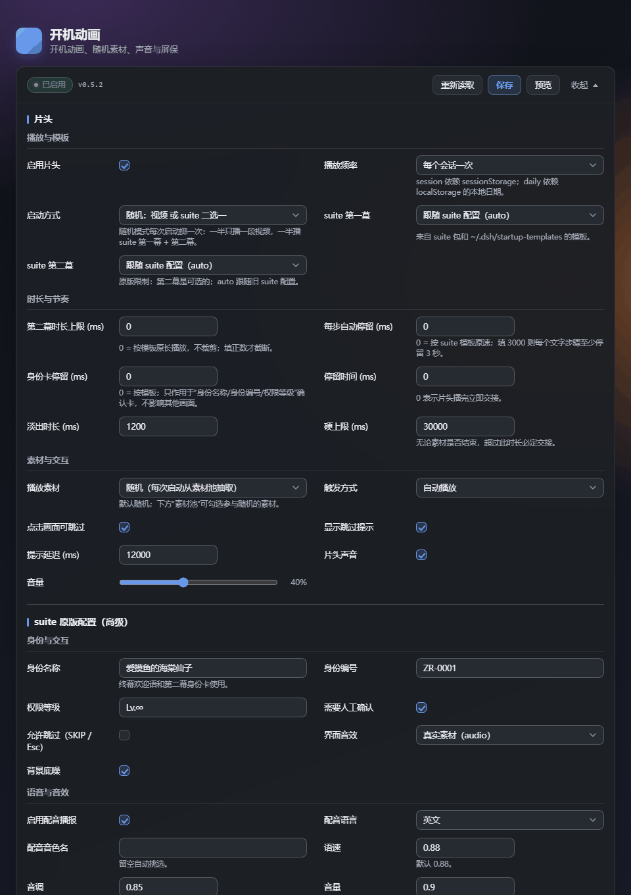
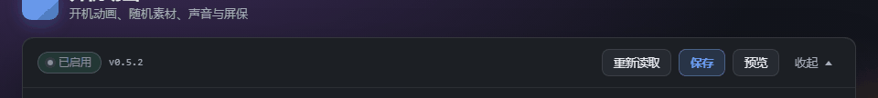

<div align="center">


<h1>dsh-boot-nexus</h1>

**开机动画、suite 两幕、屏保、素材池 —— 一个插件全搞定。**

给 DeepSeek Harness 的一套开机仪式：每次启动只播一件事，所有参数都在一张卡片里改。

[](package.json)
[](LICENSE)
[](#验证状态)
[](https://github.com/zeki520/dsh-boot-nexus)

[安装](#安装) · [它能做什么](#它能做什么) · [设置卡](#设置卡) · [配置](#配置) · [文档](#文档) · [致谢](#致谢)



</div>

---

## 致谢

这个插件不是从零写出来的。开机视频的全窗口播放与淡出衔接来自 **[lxj5820/dsh-boot-animation](https://github.com/lxj5820/dsh-boot-animation)**；suite 六幕引擎、模板、语音与音效体系来自 **[LeeRolling/dsh-boot-suite](https://github.com/LeeRolling/dsh-boot-suite)**。两位作者都选择了开源，nexus 才有东西可以合并。

**如果你喜欢这套开机动画，请先去给原作者点 ⭐：** [lxj5820/dsh-boot-animation](https://github.com/lxj5820/dsh-boot-animation) · [LeeRolling/dsh-boot-suite](https://github.com/LeeRolling/dsh-boot-suite)。完整说明见文末[致谢与来源](#致谢与来源)。

---

## 它能做什么

- **一次只播一件事。** 片头、suite 两幕、屏保共用同一个根节点、同一个状态机、同一个时钟，不会出现两个插件抢同一层画面的情况。
- **两套引擎，择一或随机。** 50% 随机在 animation 视频池与 suite 原版两幕之间轮换，也可以固定成其中任意一种。
- **改完立刻看。** 设置卡里保存后可在页面内直接预览，不用重启；30 多个可调项覆盖时长、音量、模板、身份、BGM、转场、颜色。
- **自包含。** suite 引擎、模板、语音与音效都随插件发布；旧插件删掉后仍然能播。

---

## 安装

```powershell
git clone https://github.com/zeki520/dsh-boot-nexus.git
cd dsh-boot-nexus
npm run build
$v = (Get-Content package.json -Raw | ConvertFrom-Json).version
npm pack --pack-destination "$env:USERPROFILE\dsh-plugins"

dsh plugin --profile desktop remove dsh-boot-nexus
dsh plugin --profile desktop add "file:$env:USERPROFILE/dsh-plugins/dsh-boot-nexus-$v.tgz"
```

装完完全退出并重开 DSH。首次运行会自动建好素材目录，把片头视频放进 `$DSH_HOME\boot-nexus\media\clips`、屏保放进 `...\savers`，就能在设置卡里勾选。

更细的说明（同版本 tarball 复用、离线/内网安装、回滚）见文末 [安装细节](#安装细节从源码--离线)。

---

## 设置卡

一张卡片管理全部行为，顶部工具条固定显示当前状态与版本，随时保存、预览或收起：



- 10 个分区、93 个控件，全部平铺，不需要二次展开；
- 两列字段网格，窄窗口自动降为单列；
- 所有控件有可访问名称，错误与保存状态通过 live region 播报。

---

## 为什么需要它

两个插件单独都能工作，同时启用时不是"版本不兼容"，而是"同一时刻两个主人"：

- `#dsh-startup-root`（`z-index: 2147483000`）与 `.dshba`（`2147483647`）同时存在，animation 恒盖住 suite，但 suite 的 188 KB 运行时、音频、语音照跑；
- 两边都写 `html.dsu-lock`、caption、媒体节点，后写者覆盖先写者；
- 两边都订阅 `webserver/index-inject`，行序由订阅者激活顺序决定，插件无法仲裁；
- suite 9 秒无条件拆层，animation 15 秒才提示，9–15 秒出现两次退场；
- 三份配置（`dsh-startup.json`、`chat-wallpaper.json`、animation 的 settings 命名空间）各自认为自己是真相。

nexus 的做法：宿主侧只产出一份 plan 和一套注入行；浏览器侧只有一个根节点、一个状态机、一个时钟；旧插件必须禁用，nexus 检测到旧行时**主动让位**而不是竞速。

---

## 目录

```text
dsh-boot-nexus/
  package.json
  cordis.patch.yml          # 单 insert：id boot-nexus
  assets/icon.svg
  src/
    index.js                # Host 组合根
    shared/constants.js
    host/
      config.js             # 唯一 schema / 迁移 / 原子写
      css.js                # 关键 CSS（唯一 z-index）
      rows.js               # 4 行注入 + 幂等 + 旧哨兵让位
      assets.js             # MIME / allowlist / Range
      routes.js             # 5 条路由 + trust fence
    runtime/
      00-constants.js
      10-fsm.js             # 状态机（纯函数）
      20-clock.js           # 唯一 timer/rAF 袋
      30-media.js           # video/image 适配
      40-stage.js           # 唯一 root / lock / caption / phase
      50-boot.js            # 门控、编排、交接、屏保
    client/
      index.js              # clientReady + 单一设置卡
  scripts/build-runtime.mjs # 拼 IIFE → lib/runtime.js
  lib/runtime.js            # 构建产物（58.3 KB）
  test/                     # 60 个 node:test 用例
  docs/
```

---

## 构建与测试

```powershell
npm test
```

期望：

```text
runtime: 58284 bytes (ok; budget 65536, hard 98304)
ℹ tests 60
ℹ pass 60
ℹ fail 0
```

只跑构建：

```powershell
npm run build
```

检查产物：

```powershell
Get-Content lib/runtime.meta.json
```

---

## 配置

唯一文件：

```text
$DSH_HOME/dsh-boot-nexus.json
```

首次启动会从旧文件只读迁移一次：

- `$DSH_HOME/dsh-startup.json`
- `$DSH_HOME/chat-wallpaper.json`
- animation 的 `dsh-boot-animation.json` / `boot-animation.json` / `settings/boot-animation.json` 候选

迁移规则、字段默认值与范围见 `docs/DESIGN.md` §7。旧文件不会被改写；未知键保留在 `legacy.*`。

行为字段**不放进** `cordis.patch.yml`：patch 里只有 `configFile` / `mediaDir` 两个宿主路径，避免第二份真相。

设置卡顶部会直接显示以下路径，方便用户找到文件：

```text
素材目录：$DSH_HOME/boot-nexus/media
suite 引擎目录：<插件包>/assets/suite
配置文件：$DSH_HOME/dsh-boot-nexus.json
```

---

## 素材与自包含

```text
$DSH_HOME/boot-nexus/media/
  clips/    片头
  savers/   屏保
```

支持 `mp4/webm/mov/png/jpg/webp/gif/avif`。SVG 会被拒绝（可携带脚本）；隐藏文件、目录、>512 MB 文件会被跳过。素材按文件名排序后生成稳定 id（`clip-1`、`saver-1`）。

animation 的 5 个片头 / 7 个屏保视频**不放进 npm 包**（第三方素材授权限制），而是放在上面的数据目录。它们属于插件数据，不随 `node_modules/dsh-boot-animation` 删除；删除旧 animation 插件后 nexus 仍能播放。

suite 的引擎、模板、语音与音效已经 vendored 到插件包：

```text
assets/suite/
  lib/splash.js
  lib/assets/...
  templates/...
```

`findSuitePackage()` 优先使用这份 vendored 副本；只有它缺失时才回退到 profile 里的 `dsh-boot-suite`。所以删除旧 suite 插件后 nexus 仍能播放 suite 两幕。用户导入的 `custom-*` 模板在 `$DSH_HOME/startup-templates`，同样不随旧插件删除。

---

## 安装细节（从源码 / 离线）

从源码打包：

```powershell
npm run build
$v = (Get-Content package.json -Raw | ConvertFrom-Json).version
npm pack --pack-destination "$env:USERPROFILE\dsh-plugins"
```

然后在终端（desktop profile 由 Electron 管理，先完全退出 DSH）：

```powershell
dsh plugin --profile desktop remove dsh-boot-nexus
dsh plugin --profile desktop add "file:$env:USERPROFILE/dsh-plugins/dsh-boot-nexus-$v.tgz"
```

同版本 tarball 可能被 pnpm 复用；换版本或先 remove 再 add。安装后重启 DSH。不要手写 profile 的 `package.json`（除非 pnpm 解析网络失败，见下），不要在 profile 目录跑 `pnpm`。

装完可以不解包直接验证安装产物是否自洽：

```powershell
node scripts/verify-installed.mjs
```

该脚本用假 Cordis context 跑一遍真实安装包：注入 4 行、5 条路由、计划里的素材数量与版本号都要对得上。默认读 `%USERPROFILE%\.dsh\profiles\desktop`，用 `DSH_PROFILE_DIR` 指向别的 profile。

回滚：`dsh plugin --profile desktop remove dsh-boot-nexus`，重启。旧插件行仍在 profile 的 `cordis.patch.yml` 里，把 `disabled: true` 改回 `false` 即可恢复（nexus 不修改旧配置）。

### 离线/内网环境安装

`dsh plugin add` 会用 DSH 自带 pnpm 解析整个 profile，其中可能有依赖挂在 GitHub Release 上。若解析阶段报 `UNABLE_TO_VERIFY_LEAF_SIGNATURE` 或 `UND_ERR_HEADERS_TIMEOUT`，可以绕过 CLI，手工把 tarball 写进 profile 再本地安装：

1. 把 `%USERPROFILE%\.dsh\profiles\desktop\package.json` 里 `dsh-boot-nexus` 的 spec 改成 `file:<tarball 绝对路径>`；
2. 同一个 profile 的 `pnpm-lock.yaml` 里把 `dsh-boot-nexus` 的 importer specifier/version 与 package/snapshot 头同步成新版本，并更新 integrity（`sha512-…`，从 `npm pack` 输出的 `shasum`/`integrity` 可取）；
3. 在 profile 目录执行 `pnpm install --frozen-lockfile`。

profile 没有独立状态文件，安装关系全部由 `package.json` + `pnpm-lock.yaml` 派生，所以手工安装与 CLI 等价。

---

## 运行时可用的诊断

```js
__BOOT_NEXUS__.state          // arming / playing / handoff / revealed / saver
__BOOT_NEXUS__.phase
__BOOT_NEXUS__.failed
__BOOT_NEXUS__.plan
__BOOT_NEXUS__.on(e => console.log(e))
__BOOT_NEXUS__.skip()
__BOOT_NEXUS__.preview()
__BOOT_NEXUS__.dispose()
```

URL 开关：

| 参数 | 作用 |
|---|---|
| `?dbn=off` | 不接管，走原生启动 |
| `?dbn=preview` | 绕过 session/daily，强制播 |
| `?dbn=diag` | 开启运行时诊断日志（`__BOOT_NEXUS__.logs`） |

---

## 启动方式（A/B）

每次启动按 `boot.choice` 掷一次：

- `random`（默认）：约 50% 走 A，50% 走 B；
- `clip`/`animation`：只播 animation 的随机视频池，一段；
- `suite`：只播 suite 原版引擎的 `archive-warm` 第一幕 + 第二幕（默认跟随 suite 配置，可设为 `none`）。

suite 的两幕都由 suite 自己的 `splash.js` 负责，nexus 不会在 suite 结束后追加动画池。`suiteAct2Ms=0` 表示按模板原长播放；正数才裁剪。任何 suite 失败都直接揭幕（fail-open），不会回退到视频池。

设置卡里可直接改：启动方式、第一幕/第二幕模板、第二幕时长上限、素材池勾选，以及 suite 原版的 BGM/身份/交互/语音/转场等字段。所有字段平铺显示，不需要再点展开；颜色用中文名选择（值仍写回 suite 需要的 hex）。

---

## 验证状态

| 项 | 状态 |
|---|---|
| 单测 60/60 | ✅ |
| 运行时构建 58.3 KB | ✅ 58284 B（预算 64 KB） |
| Desktop 实机（0.3.3：suite 两幕 + 声音 + 无第三段） | ✅ |
| 设置卡（分组面板、中文颜色、路径显示） | ✅ |
| 插件列表 / 设置卡图标（0.4.1） | ✅ 已实机确认插件卡；顶部内置配置项左图标为 DSH 固定映射，0.4.2 在摘要行加插件自带小图标 |
| 顶部设置项摘要小图标（0.4.2） | ✅ |
| suite 每步停留可调（0.4.3） | ✅ 已实现：`suiteHoldMs` 0=模板，>0 抬高每步下限 |
| 页面内预览（0.4.3） | ✅ 已实现：保存后取新 plan，dispose 重跑，不刷新页面 |
| 身份卡单独停留（0.4.4） | ✅ 已实现：`suitePopupMs` 只抬高 confirm 卡，其他步骤不动 |
| 设置卡改版（0.5.0） | ✅ 1040 / 760 / 520 px 三档宽度离线渲染通过；面板恒 #1c1f24，正文 14.2:1、说明 7.3:1 |
| 无障碍修订（0.5.1） | ✅ 93/93 控件有名称、7 个分区有 `aria-labelledby`、live region 常驻、保存中焦点不丢 |
| 版本号显示（0.5.2） | ⏳ 0.5.2 已装（哈希与工作区一致），待重启 DSH 后目视确认工具条显示 `v0.5.2` |
| 旧插件禁用 | ✅ 两条 insert 行均 `disabled: true` |
| 删除旧插件后自包含（0.3.4） | ✅ 临时改名 `dsh-boot-suite` / `dsh-boot-animation` 后，vendored suite 与数据目录素材仍可用 |

---

## 文档

| 文档 | 内容 |
|---|---|
| [docs/DESIGN.md](docs/DESIGN.md) | 两插件冲突分析、合并后的状态机与字段设计、迁移规则 |
| [docs/TEST-PLAN.md](docs/TEST-PLAN.md) | 部署步骤与逐项验收清单 |
| [docs/SUITE-ENGINE.md](docs/SUITE-ENGINE.md) | suite 原版引擎的 vendored 接入与 token 路由 |
| [docs/screenshots](docs/screenshots) | 设置卡与工具条截图、仓库图标 |

---

## 版本记录

当前 `0.5.2`：60 个单测通过，suite 原版引擎与 animation 随机池均实机通过；旧插件仍保留但已禁用，删除它们不影响 nexus。

- `0.4.0` 加入 64/128/256 图标与设置卡图标；
- `0.4.1` 修复设置卡 suite 生效配置回显，manifest 图标改用 128px；
- `0.4.2` 在顶部设置项摘要行加 18px 小图标；
- `0.4.3` 新增 suite 每步自动停留（毫秒）与页面内预览；
- `0.4.4` 新增身份卡单独停留（`suitePopupMs`）；
- `0.4.5` 修复保存后 suite 字段被 POST 响应清空、预览结束后黑屏不自动退出；
- `0.5.0` 设置卡改版：近不透明分组面板、两列字段网格、吸顶工具条（状态/版本/保存/预览/收起）；
- `0.5.1` 无障碍与审查修订：93 个控件全部有可访问名称、常驻 live region、保存期间焦点不丢失、控件边界与非文本对比度达标、渲染异常有兜底卡片；
- `0.5.2` 工具条显示插件版本号，补齐 MIT 许可与可移植的安装校验脚本。

设计与冲突分析见 [docs/DESIGN.md](docs/DESIGN.md)，部署与验收见 [docs/TEST-PLAN.md](docs/TEST-PLAN.md)，suite 引擎接入见 [docs/SUITE-ENGINE.md](docs/SUITE-ENGINE.md)。

---

## 致谢与来源

nexus 的每一帧画面，几乎都能追到这两个仓库：

| 项目 | 作者 | 这里用到了什么 | Star |
|---|---|---|---|
| [dsh-boot-animation](https://github.com/lxj5820/dsh-boot-animation) | **lxj5820** | 全窗口视频片头、播完淡出交还应用、素材池与随机选片 | [⭐ 去点](https://github.com/lxj5820/dsh-boot-animation) |
| [dsh-boot-suite](https://github.com/LeeRolling/dsh-boot-suite) | **LeeRolling** | 六幕冷启动引擎、模板 / 语音 / 音效、设置卡与身份卡 | [⭐ 去点](https://github.com/LeeRolling/dsh-boot-suite) |

nexus 做的是把它们合到同一层画面里：一个根节点、一个状态机、一个时钟、一份配置、一张设置卡。**引擎、素材与设计思路都来自上面两位作者的开源工作**，遇到播放问题也请先看原仓库的文档与 issue。

如果这个插件帮你省了事，请把 ⭐ 点给源头：

- ⭐ [lxj5820/dsh-boot-animation](https://github.com/lxj5820/dsh-boot-animation)
- ⭐ [LeeRolling/dsh-boot-suite](https://github.com/LeeRolling/dsh-boot-suite)

---

## 许可证

[MIT](LICENSE) © 2026 zeki520
